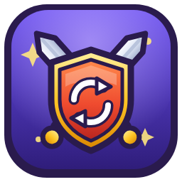
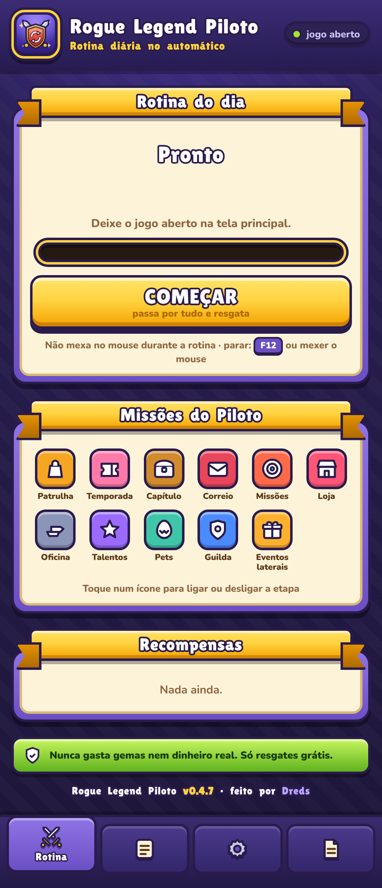

# Rogue Legend Piloto

**A screen bot that does the daily routine of *Rogue Legend* for you.**
It looks at the game window, reads it with OCR and computer vision, and clicks only free rewards.

---

> **🚧 Beta, in development.** This page describes what the project does and how it works. The code and the ready-to-run download will be published here once it's ready. Watch the repo to get notified.

## What it does

With *Rogue Legend* open in **Google Play Games on PC**, one button runs through every essential menu and claims what's free:

| Step | What it handles |
|---|---|
| Patrol | claim, then free Quick Patrol runs (and the energy x10 option, if enabled) |
| Season / Chapter | season pass and chapter rewards |
| Mail | *Claim all* |
| Missions | login, daily, weekly and achievement tabs, then the point-bar chests |
| Shop | Silver and Obsidian chests by video or keys, opened again and again until the keys run out (15/10 → 5/5 → 0/1); the featured **Chromatic Chest** with keys only (Get 10 when possible, then one by one, never with gems); artifacts and free gem/gold refills |
| Workshop | opens the Equip tab (and checks it really opened), then *Quick Synthesize* while there's something to merge |
| Talents | reads gold and cost, buys in bursts in the order ATK → HP → DEF; when all three max out it confirms *Hero ranked up!* and keeps spending on the next tier |
| Pets | eggs planned as 30x/10x/1x pulls (a pull button is used only when the number above it equals its egg cost, never gems), then the free video pulls |
| Guild | every room: free donation, tasks, vault |
| Side events | each event once: sub-tabs found by label or red dot (tasks/missions → packs/cause → pass), small green *Claim* buttons found by color and shape, the free pack (yellow, no price), point-bar chests (opens the last one your points reach), 10x pulls only with 10+, the pachinko until it runs out, then the tasks and pass again |

It keeps looping through the enabled steps until a full pass finds nothing new, then goes back to the home screen and stops.

> The UI is in Portuguese, the language I play in.

## Safety rules

The whole point is that it can run unattended without ever spending anything:

- **Never gems, never real money.** Any text with `$`, a price with two decimals (it even catches OCR reading `$0,99` as `SO.99`) or a timer is blocked.
- **Whitelist / blacklist.** It only clicks buttons whose text *is exactly* a claim word, and only if the button is colored (active). Words like delete, buy, sell, dismantle, leave, subscribe, pack and offer are never clicked.
- **Buttons without text** (video, key, pull) only get clicked when they show the red notification dot **and** have no price or gem cost inside.
- **Key counters are read, not guessed.** A key button is pressed only when it reads *have ≥ cost* (e.g. `2/1`, `12/10`); a plain number means gems and is never clicked.
- **Tiny green claim buttons** inside events (too small for OCR) are recognized by color and shape, and skipped if any price or number is near them.
- **Calibration lock.** If the home screen isn't where the map expects, it stops before doing anything.
- **Stops instantly** with `F12`, moving the mouse, or the Stop button. If the game loses focus three times, it stops.
- Human-like pace: random 0.6–1.2 s pauses and up to 3 px of click jitter.

## How it sees the game

- Finds the window by title, captures it with **mss**, trims the black side bars and crops the 9:16 game area.
- Everything is measured on a **normalized 540×960 frame**, so it works with the window at any size.
- **RapidOCR** reads button labels (accent- and space-insensitive matching).
- **Red dot detection:** HSV mask plus filled-contour size filter, calibrated on real screenshots. It even finds dots with numbers inside.
- **Template matching (OpenCV)** for the close **X** and the back arrow (0.99 on real popups vs ≤ 0.75 on false positives; threshold 0.86).
- Clicks go through the Win32 API in one of two modes, chosen by a self-test at startup: **background** (`PostMessage` mouse messages to the game's child window, cursor untouched) or **cursor** (`SetCursorPos` + `mouse_event`, window in front). Always only inside the game frame.
- Navigation is verified: it taps once and waits for the expected screen; it taps again only if the previous screen is still there (no double taps landing on whatever opened).
- Works with the window at any size: fine reads (counters like `1/1`) scale with the real game width, and the game area is measured from the widest bright frame so dark popups don't shrink it.

The app window is **pywebview** (Edge WebView2) with an HTML/CSS UI. The engine runs in a thread and streams events (step, lap, counts, log) to it.

## Disclaimer

Personal project, not affiliated with the developers of *Rogue Legend* or with Google. Automating a game may go against its Terms of Service. Use it on your own account and at your own risk.

## License

[MIT](LICENSE) (applies to the code once it's published) · made by [André Miller Fleck (Dreds)](https://github.com/DredsGG)
